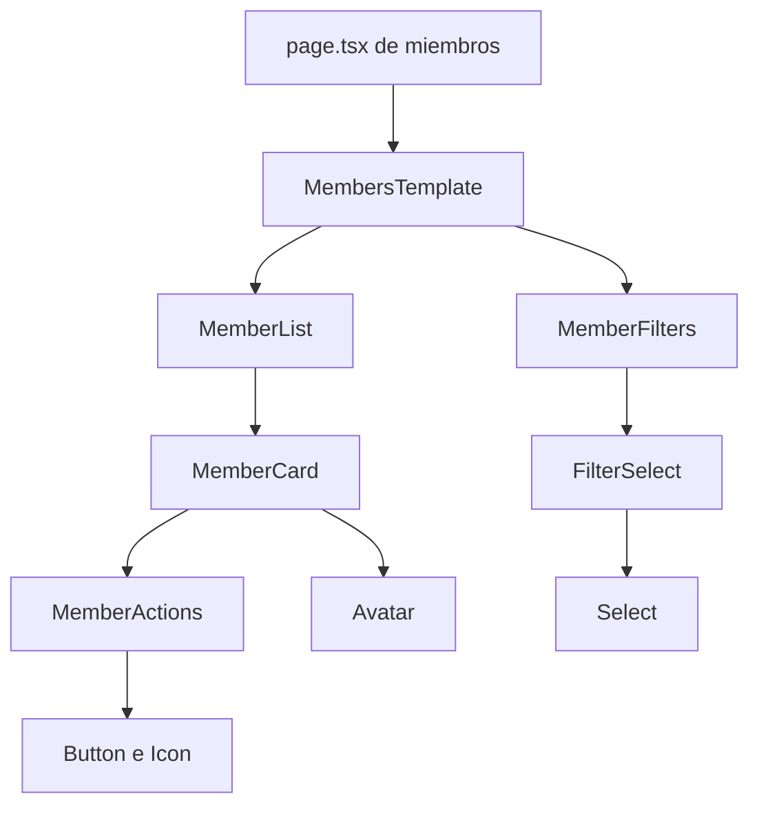

# Atomic Design en gimnasio

## Átomos

- `Button`, `Input` y `Select` envuelven los controles nativos. `Input` también admite radios y casillas.
- `Logo` muestra el logotipo. `Avatar` presenta la foto del miembro o un icono cuando la imagen no está disponible. `Icon` dibuja los iconos de la interfaz.

## Moléculas

- `SearchBar` combina un icono, un campo de búsqueda y el botón SMS.
- `FilterSelect` adapta el control `Select` a cada filtro.
- `FormField` reúne la etiqueta y su control `Input`.
- `PlanFeature` presenta un beneficio con su estrella.
- `MemberInfo` muestra los datos de la tarjeta e incorpora el icono de identificación.
- `MemberActions` incluye los enlaces, iconos y botones de la tarjeta.

## Organismos

- `Header` incluye `Logo` y puede mostrar `SearchBar`, el menú o el enlace de regreso.
- `BottomNavigation` reúne los accesos inferiores con `Icon` y `Button`.
- `PlanList` organiza las tarjetas `PlanCard`, que muestran los beneficios con `PlanFeature`.
- `MemberList` organiza las tarjetas `MemberCard`, compuestas por `Avatar`, `MemberInfo` y `MemberActions`.
- `MemberFilters` usa tres instancias de `FilterSelect`.
- `MemberForm` utiliza `FormField`, `Input`, `Select` y `Button` para capturar los datos.

## Templates y páginas

| Página | Template | Organismos principales |
| --- | --- | --- |
| `/` | `PlansTemplate` | `PlanList` |
| `/miembros` | `MembersTemplate` | `Header`, `MemberFilters`, `MemberList`, `BottomNavigation` |
| `/miembros/nuevo` | `MemberFormTemplate` | `Header`, `MemberForm` |
| `/miembros/[id]/editar` | `MemberFormTemplate` | `Header`, `MemberForm` |

Los archivos `page.tsx` contienen las URLs y las llamadas a MockAPI. Los filtros y la búsqueda se aplican en la página del listado. El formulario compartido prepara los valores y llama a la función que recibe de su página.

